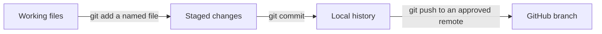

# 5. Use Git and GitHub

**Goal:** Save focused changes and explain how they reach a pull request.

**Git** records file history. **GitHub** hosts repositories and adds tools such as issues, PRs and Actions. You can use Git locally before connecting to GitHub.

## Three places to understand



Editing changes your working files. Staging selects the changes for the next commit. Committing saves that selection locally. Pushing sends commits to a remote repository.

A branch points to a line of work. It lets you prepare a change while `main` remains the shared integration branch. A PR asks to combine the branch's changes with its target branch.

## Start a separate practice repository

**Location:** An ordinary folder chosen for classroom practice. These commands create a new subfolder and Git history there.

```bash
git init -b main student-practice
cd student-practice
```

Create `learning-notes.md` in your editor. Write two sentences about startup checking. Then run:

```bash
git status
git add learning-notes.md
git commit -m "Add initial learning notes"
git switch -c practice/startup-help
```

If Git asks for an author name or email, follow your mentor's instructions for a repository-local identity. Use an approved address or GitHub privacy address. This activity does not require changing global settings.

Add a third sentence to the file. Inspect and save the change:

```bash
git diff
git add learning-notes.md
git diff --staged
git commit -m "Explain the purpose of startup checks"
git log --oneline -3
```

`status`, `diff` and `log` read information. `add` changes the staging area. `commit` changes local history. `switch -c` creates and selects a branch.

Use named files when staging so you can explain exactly what the commit includes.

## Connect the practice work to GitHub

A mentor can provide a practice remote and instructions for pushing your branch. Confirm that remote belongs to the practice exercise before sending changes. Opening a PR on the production repository is a separate contribution decision.

A PR branch can contain several commits. In SDE's PR #162, the first implementation commit and its test-helper correction were combined by a **squash merge** into one main commit. The PR preserves their review history.

## Practice

Show a partner your working tree, staging area and latest commit. Explain which command would send the commit to GitHub. Do not push until the practice remote is confirmed.

## Check your understanding

- Does committing automatically send a change to GitHub?
- Why might the merged main commit have a different ID from the PR head?

[Next: your development environment](06-development-environment.md)
