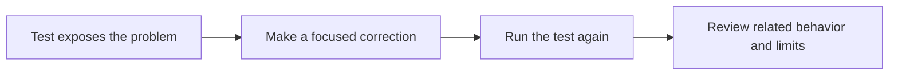

# 8. Write useful tests

**Goal:** Match each claim to a check that can support it.

A test creates a situation, performs an action and compares the result with an expectation. A useful failure tells us something specific that needs attention.

A **regression** is a problem that returns after it was fixed, or an existing behavior that a new change breaks. A regression test helps keep that problem from returning unnoticed.

## Different tests answer different questions

| Test type | Question it can answer | Important limit |
| --- | --- | --- |
| Unit | Does this small piece behave as expected? | Other pieces may be replaced with test substitutes. |
| Integration | Do these pieces work together at a particular boundary? | The rest of the system may still be absent. |
| Browser | Do the rendered screens and interactions work in a browser? | It does not prove native installer or permission behavior. |
| Native/platform | Does behavior work with the operating system and its rules? | A controlled test setup does not reproduce every owner device. |
| Contract | Does a component follow an agreed rule? | Some contracts inspect source; others execute behavior. Read what each test does. |
| Owner UAT | Can a person complete the intended task on the exact candidate? | Unobserved situations remain unobserved. |

A **mock** replaces a component with controlled test behavior. A **fixture** is the setup used to exercise a situation. They make difficult cases repeatable, but their limits must be recorded.

## The startup regression

The App test deliberately held the safety result back. Before the fix, validation was already submitted. After the fix, validation waited.

The queue test also records the order of operations. These are real assertions from `nativeReadQueue.test.ts`, shown at different points in the test:

```typescript
expect(calls).toEqual(["safety"]);
expect(calls).toEqual(["safety", "validation"]);
expect(calls).toEqual(["safety", "validation", "diagnostic"]);
```

The arrays mean “only these calls have started so far, in this order.” The test controls when each phase can finish.

This is more precise than waiting a fixed number of seconds and hoping nothing overlaps.

## Red, green and review



A test should fail for the intended reason before you use it as evidence for a fix. After it passes, check neighboring requirements too. Do not remove the useful assertion merely to get a green result.

Some protected SDE tests cannot exercise their protected work in a non-administrator environment. A local invocation that exits successfully is not proof those assertions ran. Required CI environments enforce the needed conditions.

## Practice

Write a test table for delayed safety, real activity and an unavailable result. State which checks need only controlled observations and which need actual operating-system behavior. For the help document, write a review question that would catch the false claim “Check again always fixes it.”

## Check your understanding

- What does a mock help you control?
- What additional evidence would you need after a queue unit test passes?

[Next: GitHub CI](09-github-ci.md)
