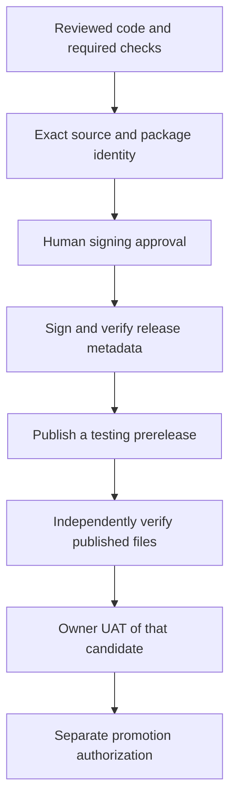

# 12. Prepare a release

**Goal:** Explain how tested code becomes a verified candidate people can evaluate.

CI checks code as it changes. Release work identifies the exact source and packages we intend to share, verifies them and obtains the required approvals.

## What does CD mean?

| Term | Meaning |
| --- | --- |
| Continuous integration | Regularly combine changes and check them automatically. |
| Continuous delivery | Use a repeatable process to prepare software for release, with an approval step when needed. |
| Continuous deployment | Automatically deploy changes that meet the configured requirements. |

SDE automates many build and verification steps. Its release process still has explicit human signing, owner UAT and separate promotion decisions. A green PR does not send a new version to every student's computer.

## Versions, tags and packages

A version names a software release. A Git tag labels a particular source commit. A package contains the application files and installation instructions for a platform.

SDE produces a Windows `.exe` installer and a Linux `.deb` package. Release preparation must confirm that their identities and versions match the intended candidate.

The source manifests intentionally retain `1.2.1` in this project. Published candidate identity follows a separate controlled preparation process. Reading one manifest does not establish the current published version, and a beginner should not bump every version field to prepare a release.

## The release path

Eligibility rules determine which runs can reach the release job. An ordinary PR run normally skips release. The protected signing environment is named `sde-release-signing`.

## Three different kinds of evidence

**A test result** supports a behavior claim within its tested conditions.

**A checksum** is a fingerprint of file contents. Comparing it with a trusted expected value helps detect changes to those contents.

**A digital signature** helps authenticate data against a trusted public key. The private signing key remains protected. Students do not need that key for these lessons.

SDE signs update metadata that identifies the release and its payloads. The source code uses a pinned trusted public key to verify it. File integrity and publisher authentication both matter; neither replaces behavior testing.

The release publishes five main files: the two installers, `SHA256SUMS.txt`, `sde-update.json` and `sde-update.json.minisig`. The candidate record keeps their exact identities and verification results.

## Practice

Complete a mock candidate record using placeholders clearly labeled **Practice only**. Identify which fields would require real source, package, signature and human evidence. Do not create a tag, approve signing or publish a release.

## Check your understanding

- What does a tag identify?
- Why does a checksum alone fail to establish who published a file?
- Which decisions still need people in SDE's release process?

[Next: owner UAT](13-owner-uat.md)
