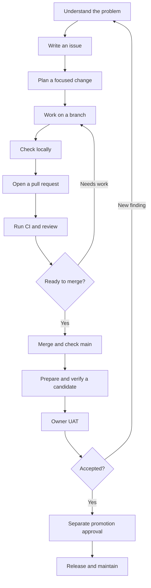

# From an idea to a release

## A student manual for development, CI and delivery

**Audience:** Students beginning high school, with little or no programming experience.

**Status:** Project reference manual, first edition. Student classroom testing has not yet been conducted.

**Repository examples checked:** November 14, 2026.

Software development means more than writing code. We need to understand a problem, make a focused change, check our work and explain our results. Before sharing software, we also need to verify the exact files people will receive.

This manual follows that process using Skyview Dev Setup, or **SDE**. SDE helps prepare and check development computers. Because it can install software and change settings, its safety rules matter as much as its screens.

You do not need to understand all of SDE's code to begin. Learn the purpose of each step first. Then practice the smaller skills.

## The learning path

| Chapter | By the end, you should be able to… | Practice or evidence to produce |
| --- | --- | --- |
| [1. Meet the project](01-meet-the-project.md) | Find the main kinds of files and explain their jobs. | A short repository map. |
| [2. Follow the development cycle](02-development-cycle.md) | Explain how a user report becomes tested software. | A diagram and a responsibility map. |
| [3. Describe the problem](03-write-an-issue.md) | Write an issue with a clear expected result. | A practice issue and acceptance criteria. |
| [4. Plan the change](04-plan-a-change.md) | Break a task into steps and name what needs evidence. | A small implementation and test plan. |
| [5. Use Git and GitHub](05-git-and-github.md) | Explain branches, commits and pull requests. | Two commits in a practice repository. |
| [6. Prepare your workspace](06-development-environment.md) | Explain tools, dependencies and lockfiles. | A tool inventory and setup notes. |
| [7. Check a change locally](07-local-development.md) | Inspect a focused change and run an appropriate check. | A local check record. |
| [8. Write useful tests](08-testing.md) | Explain different test types and what each proves. | A regression-test plan. |
| [9. Follow GitHub CI](09-github-ci.md) | Trace the main workflow and read its status. | A workflow observation sheet. |
| [10. Investigate a failure](10-debug-ci.md) | Find useful evidence and propose a justified correction. | A failure investigation. |
| [11. Review and merge](11-review-and-merge.md) | Review a PR and explain required checks. | A practice review and merge checklist. |
| [12. Prepare a release](12-release-and-delivery.md) | Explain versions, packages, signatures and delivery approvals. | A mock candidate record. |
| [13. Test as an owner](13-owner-uat.md) | Record honest user acceptance testing results. | A practice UAT sheet. |
| [14. Maintain and hand off](14-maintenance-and-handoffs.md) | Report a new finding and leave a useful checkpoint. | A follow-up issue and handoff. |

Keep the [glossary](glossary.md) nearby. Use the [continuing case study](case-study.md) to connect the chapters. The [workbook](workbook.md) supplies reusable forms. The [source record](sources.md) links the repository evidence behind the examples.

Chapter 9 uses the existing [CI Student Guide](../CI-STUDENT-GUIDE.md) as its main reading. That guide remains a standalone introduction.

## The whole process at a glance

The return arrows are normal. Finding a problem before release is useful progress. The goal is trustworthy evidence, not a screen full of green symbols at any cost.

## How to use this manual

Read in order for your first pass. For each chapter:

1. Read the explanation and follow its repository example.
2. Do the practice activity in an approved practice repository.
3. Answer the short “Check your understanding” questions.
4. Keep your result in a learning notebook or the workbook.

For a shorter introduction, read Chapters 1–3, the CI Student Guide, and Chapters 12–13 first. Return to the tool and testing chapters when you are ready for hands-on work.

Diagrams use Mermaid, which GitHub can display. Each diagram also has a written explanation, so you can follow the lesson without a diagram viewer.

## Practice boundaries

The continuing example is a real SDE problem. Student activities use a small practice document rather than reimplementing its production fix.

Use a mentor-approved practice repository for edits, pushes and merges. Read-only browsing of the real project is part of the lessons. Do not run installation, Repair, system recovery or release commands as a classroom exercise. Signing and promotion belong to authorized maintainers.

Commands are labeled by purpose and location. A command that reads information differs from one that changes files. Ask your mentor when the required tool or practice location is unclear. No activity requires changing global Git settings, clearing locks or damaging a computer to create a test case.
