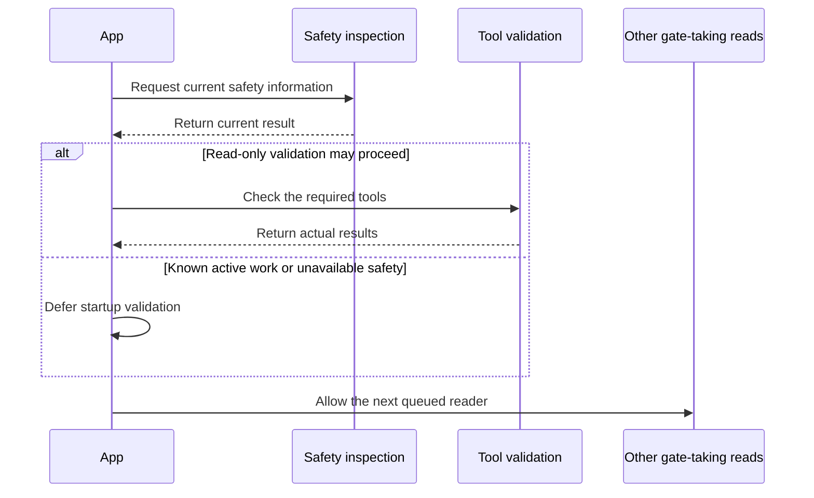

# Continuing example: a check that needs a second click

## The user experience

During owner testing, SDE showed **Check not finished** when it opened on a Linux Mint computer. Clicking **Check again** cleared the message.

The useful question was: **Can normal startup finish its check without requiring that extra click, while keeping genuine safety problems visible?**

## What the evidence established

The source code started safety inspection and tool validation separately. Both could need the same native operation gate. A gate controls work that must not happen at the same time.

A regression test delayed the safety result. It showed that the old app submitted validation before safety finished. This confirmed a code-level overlap.

That test did not prove the exact cause of the owner's particular laptop failure. The implementation record keeps that distinction. A plausible explanation becomes a confirmed explanation only when the relevant evidence supports it.

## The implemented change

The startup fix makes these reads take turns:

This diagram is a teaching summary of the normal completed sequence. Errors and outdated results have their own handling in the source. A queue coordinates this window's reads; it does not grant permission to install software or override the native gate.

Tests also cover repeated effects, delayed results, navigation, unavailable safety and a genuinely active operation.

## What happened in CI

The first run passed application checks and both native build jobs. Both trust jobs failed a new test's final successful-exit assertion. The aggregate `acceptance` job failed too.

The failure came from the test helper. It closed a child process's output pipe after reading its ready signal. When the child exited normally, the Rust test runner tried to print its final result to that closed pipe.

The correction kept the pipe open and collected the output through normal exit. The successful-exit and native safety assertions stayed intact. The corrected CI run passed, and PR #162 merged.

| Record | What it supports |
| --- | --- |
| [Issue #160](https://github.com/stormbots/Tactics-Strategy-Dev-Environments/issues/160) | The reported startup problem and accepted requirements. |
| [PR #162](https://github.com/stormbots/Tactics-Strategy-Dev-Environments/pull/162) | The startup change and test-helper correction. |
| [First run](https://github.com/stormbots/Tactics-Strategy-Dev-Environments/actions/runs/43568067928) | The failed protected regression and blocked acceptance. |
| [Corrected run](https://github.com/stormbots/Tactics-Strategy-Dev-Environments/actions/runs/43581367274) | Passing applicable checks at the corrected PR head. |
| [Implementation record](../STARTUP-CHECK-IMPLEMENTATION.md) | Technical details, reader classification and remaining evidence limits. |

These records establish implementation and CI history. They do not, by themselves, accept a later release candidate or prove every owner-device behavior.

## Your practice version

Your classroom task is to write a short help document called `startup-check-help.md` in a practice repository. It explains startup checking and what a user should do when a check genuinely cannot finish.

You will write an issue, plan the document, make commits, review it, study CI evidence and prepare a mock release handoff. You will not change the real app's safety behavior.

Every sample issue, review and release record in the exercises is a teaching example unless it links to a verified real record.
